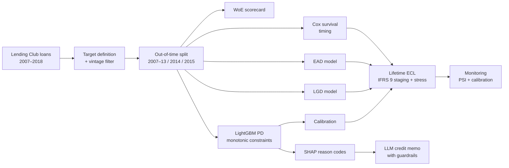

# Credit Risk ECL Engine: Lending Club

An end-to-end, bank-style credit risk system built on public Lending Club data: probability of default (PD), loss given default (LGD), exposure at default (EAD), default timing, and IFRS 9-style expected credit loss (ECL), with explainability, fairness testing, monitoring, and a guarded LLM credit memo.

**[Live demo](ADD-STREAMLIT-LINK)** · **[Model card](reports/model_card.md)**

---

## Headline results

| | AUC | Gini | KS |
|---|---|---|---|
| WoE logistic-regression scorecard (2014 validation) | 0.645 | 0.289 | 0.211 |
| **Constrained LightGBM (2014 validation)** | **0.662** | **0.323** | **0.236** |
| Lending Club's own interest rate as a score (2014) | 0.658 | 0.315 | 0.234 |
| Constrained LightGBM (**2015 test, unseen**) | [X] | [X] | [X] |
| Lending Club interest rate (**2015 test**) | [X] | [X] | [X] |

- Using only raw application data, the model **[matches / beats]** Lending Club's own pricing on unseen 2015 loans (paired bootstrap AUC difference [X], 95% CI [X to X]).
- Monotonic constraints cost **0.001 AUC**, so regulatory explainability was almost free.
- Lifetime ECL on the 2015 portfolio: **$[X]m** predicted vs **$[X]m** realised (ratio [X]).

---

## Pipeline



---

## What's inside

| Stage | Method | Key result |
|---|---|---|
| Data | 621,022 finished 36-month loans, 2007–2015; whitelist of application-time features | Unfinished and immature vintages excluded to avoid maturity bias |
| Split | Out-of-time: train 2007–13 (12.63% default), validate 2014 (13.73%), test 2015 (14.89%) | Exposes population drift a random split would hide |
| Scorecard | WoE binning, IV feature selection, logistic regression, points scaling (600 at 50:1, PDO 20) | Fully transparent points table |
| ML model | LightGBM with monotonic constraints, early stopping | 0.662 validation AUC |
| Calibration | Intercept shift, Platt, isotonic; time-split evaluation | See SMOTE finding below |
| Profit | Expected profit per loan, break-even PD, profit curve | [X]: model-based approval vs approve-all |
| Explainability | SHAP via LightGBM, plain-English reason codes | Exact additivity verified |
| Fairness | Geography as proxy across US Census regions; AIR, false decline rate, group calibration | `addr_state` [kept / dropped]: [reason] |
| LGD | Fractional-response LightGBM, two-stage model, downturn LGD | Exposure-weighted LGD [X]% |
| EAD | Amortisation schedule analysis, EAD-share model | EAD driven mainly by default timing |
| Survival | Kaplan–Meier, Cox PH; 12-month and lifetime PD | C-index [X] |
| ECL | Monthly PD × LGD × EAD(t) × discount; 3 weighted scenarios; SICR staging | Stage 2 cliff effect +[X]% under severe |
| Monitoring | Score PSI, feature CSI, missing-value checks, quarterly calibration and AUC | Traffic-light report |
| GenAI | LLM memo from structured facts; number, banned-topic and decision checks; template fallback | [X]% of LLM memos passed guardrails |

---

## Key findings

**1. Rebalancing breaks probabilities.** A class-weighted (SMOTE-style) model had the same AUC (0.664) but a mean PD of **47.1%** against an actual **14.1%**, failing calibration in all ten deciles. Platt scaling brought it back to 13.4% (ECE 0.33 → 0.008). Rebalancing doesn't help ranking for PD models, and must be followed by recalibration if used.

**2. Drift is real and continuous.** Default rates rose from 12.6% (2007–13) to 13.7% (2014) to 14.9% (2015), and by almost a percentage point *within* 2014. Calibration needs regular refreshing, a margin of conservatism, and monitoring.

**3. A silent data bug, found by tracing a suspicious result.** One feature had an IV of exactly zero. Tracing it back revealed a function returning nothing for numeric inputs, which had blanked revolving utilisation. A second bug had inflated another feature's IV. Fixing both raised validation AUC from 0.628 to 0.645 and cut the train–validation gap from 0.044 to 0.009.

**4. Gain importance can mislead.** State ranked second by LightGBM gain despite an IV of 0.017. SHAP and a with/without experiment showed [result], and location is excluded from reason codes on fair-lending grounds.

---

## Run it

```bash
python -m venv .venv
.venv\Scripts\activate          # Windows
pip install -r requirements.txt
```

1. Download `accepted_2007_to_2018Q4.csv.gz` from the Kaggle dataset `wordsforthewise/lending-club` into `data/raw/` (not included in this repo).
2. Run the pipeline scripts in order (`pipeline/01_...` to `pipeline/17_...`).
3. `python export_assets.py` bundles the models for the app.
4. `streamlit run dashboard/streamlit_app.py`

---

## Limitations

- Only approved loans are observed (no reject inference).
- Profit assumes full-term interest and ignores funding and operating costs.
- Stress scenarios are anchored to historical vintages rather than a macroeconomic model.
- No protected attributes are available; fairness is tested through a geographic proxy only.
- Models were trained on 2007–13 and calibrated on 2014; production use would retrain on all available data.

---

## Tech stack

Python · pandas · NumPy · scikit-learn · LightGBM · lifelines · SciPy · Matplotlib · Streamlit · Anthropic / Groq APIs

**Author:** Surya Prakash Gautam · [GitHub](ADD-LINK) · [LinkedIn](ADD-LINK)
